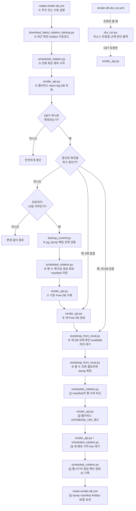

# Render Free PostgreSQL 자동 교체

LearnLog의 Render Free PostgreSQL이 만료되기 전에 데이터를 백업하고 새 DB로 교체하는 GitHub Actions 운영 가이드다.

Render Free PostgreSQL은 생성 후 30일이 지나면 만료된다. LearnLog는 만료 14일 전부터 교체 대상으로 판단하여, 주간 실행이 한 번 실패해도 다음 실행에서 다시 시도할 수 있게 한다.

## 운영 요약

| 항목 | 설정 |
| --- | --- |
| 회전 워크플로 | `.github/workflows/rotate-render-db.yml` |
| 실행 시간 | 매주 월요일 01:00 KST (`0 16 * * 0` UTC) |
| 교체 기준 | DB 만료까지 14일 이하 |
| DB 탐색 | 매 실행마다 현재 워크스페이스의 `learn-log` 이름으로 조회 |
| 백업 포맷 | PostgreSQL custom dump (`pg_dump --format=custom`) |
| 회전 백업 보관 | GitHub Actions Artifact 90일 |
| 일반 주간 백업 | 매주 월요일 00:00 KST, 45일 보관 |
| 전체 제한 시간 | 45분 |
| DB 생성 대기 | 최대 15분, 10초 간격 조회 |
| 웹 배포 대기 | 최대 15분, 10초 간격 조회 |

DB ID를 별도 상태 파일로 보관하지 않는다. 회전을 시작할 때마다 DB 이름과 워크스페이스로 현재 대상을 다시 찾는다. Artifact에 남는 DB ID는 독립적인 상태가 아니라, 중단된 회전을 이어가기 위한 백업 manifest의 검증 정보다.

## 전체 흐름



`scheduled_rotation.py`가 전체 순서와 재실행을 제어하는 오케스트레이터다. `render_api.py`는 Render 리소스 조회·생성·삭제·배포를 담당하고, `backup_current.py`와 `bootstrap_from_local.py`는 Docker의 PostgreSQL 18 이미지로 백업·복원·행 수 검증을 수행한다.

## GitHub 설정

Repository의 **Settings → Secrets and variables → Actions**에서 설정한다.

### 필수 Secret

| 이름 | 용도 |
| --- | --- |
| `RENDER_API_KEY` | Render PostgreSQL·웹서비스 조회, DB 생성·삭제, 환경변수 갱신, 배포 시작 |

Render API Key는 세부 권한을 나누지 않으므로 절대 코드나 Actions 로그에 출력하지 않는다.

### 선택 Variable

| 이름 | 용도 |
| --- | --- |
| `RENDER_WORKSPACE_ID` | 동일한 이름의 리소스가 여러 워크스페이스에 있을 때 탐색 범위 제한 |

`RENDER_WORKSPACE_ID`가 없으면 `learn-log` 웹서비스의 owner ID를 기준으로 DB를 찾는다. GitHub이 자동 발급하는 `GITHUB_TOKEN`은 이전 회전 Artifact를 받는 데 사용하며 따로 등록할 필요가 없다.

## 안전 장치

- DB와 웹서비스가 동일한 워크스페이스에 있는지 확인한다.
- `learn-log` DB가 없거나 두 개 이상이면 임의로 선택하지 않고 중단한다.
- 정상 회전은 DB 상태가 `available`일 때만 시작한다.
- 기존 DB를 삭제하기 전에 dump 생성, `pg_restore --list` 검증, 행 수 수집, SHA-256 체크섬 생성을 모두 완료한다.
- 복원 후 핵심 테이블의 행 수가 manifest와 다르면 웹서비스를 새 DB에 연결하지 않는다.
- 같은 워크플로가 중복 실행되지 않도록 GitHub Actions `concurrency` group을 사용한다.
- API에서 받은 DB 접속 문자열은 프로세스 환경변수로만 전달하고 출력하지 않는다.

행 수를 비교하는 핵심 테이블은 다음과 같다.

- `search_learninglog`
- `search_dailyjournal`
- `search_exercise`
- `search_exerciseattempt`
- `search_mateattempt`
- `practice_concept`

스키마가 변해 핵심 테이블이 추가되거나 이름이 바뀌면 `ops/render_db_rotation/bootstrap_from_local.py`의 `CHECK_QUERY`도 함께 수정해야 한다.

## Artifact 구조

`render-rotation-backup`에는 다음 파일이 저장된다.

```text
rotation_backup/
├── learnlog.dump
└── manifest.json
```

manifest에는 백업 원본 DB ID, dump SHA-256, 핵심 테이블 행 수, 새 DB 생성 설정, 회전 완료 DB ID가 들어간다. 비밀번호나 DB 접속 URL은 저장하지 않는다.

## 수동 점검과 실행

### 변경 없는 사전 점검

GitHub Actions의 **Render DB Discovery** 워크플로를 `Run workflow`로 실행한다. DB 상태·만료일·교체 판단만 출력하고 Render 리소스는 변경하지 않는다.

로컬 `.env`에 `RENDER_API_KEY`가 있다면 다음과 같이 실행할 수 있다.

```bash
.venv/bin/python -c "from dotenv import load_dotenv; load_dotenv(); from ops.render_db_rotation.dry_run import main; raise SystemExit(main())"
```

### 회전 워크플로 수동 실행

GitHub Actions의 **Rotate Render DB**를 `Run workflow`로 실행할 수 있다. 수동 실행해도 만료까지 14일을 초과해 남았다면 아무것도 변경하지 않고 종료한다.

이 워크플로는 조건이 충족되면 운영 DB를 삭제하는 실제 회전을 수행하므로, 상태만 확인할 때는 반드시 **Render DB Discovery**를 사용한다.

## 실패와 재실행

| 실패 시점 | 상태 | 대응 |
| --- | --- | --- |
| 기존 DB 삭제 전 | 운영 DB가 그대로 남아 있음 | 원인을 해결한 뒤 **Rotate Render DB** 재실행 |
| DB 삭제 후·새 DB 생성 전 | dump와 manifest가 Artifact로 보관됨 | 재실행하면 Artifact를 받아 새 DB 생성부터 이어감 |
| 새 DB 생성 후·복원 전 | 새 `learn-log` DB와 미완료 manifest가 있음 | 재실행하면 현재 DB를 찾아 복원부터 이어감 |
| 복원 후·웹 배포 전 | DB 행 수가 manifest와 같으면 재복원을 생략할 수 있음 | 재실행하여 환경변수 갱신과 배포 재시도 |
| 완료 후 다음 주간 실행 | manifest의 완료 DB ID와 현재 DB ID가 같음 | 이전 회전 파일을 정리하고 일반 만료 판단으로 복귀 |

재실행 전에는 먼저 실패한 Actions 런의 **Preserve rotation backup and manifest** 단계가 실행됐는지 확인한다. Artifact가 없고 기존 DB도 없다면 자동화가 안전하게 복구할 수 없으므로 더 이상 실행하지 말고 수동 복구한다.

## 일반 주간 백업

`.github/workflows/backup.yml`은 회전과 독립적으로 매주 월요일 00:00 KST에 현재 DB를 백업한다. `DATABASE_URL`을 GitHub Secret에 고정하지 않고 Render API에서 현재 `learn-log` DB의 External URL을 매번 받는다. 따라서 DB가 교체돼도 백업 워크플로를 수정할 필요가 없다.

## 테스트

```bash
.venv/bin/pytest -q ops/render_db_rotation
.venv/bin/ruff check ops
python3 -m compileall -q ops
git diff --check
```

테스트는 리소스 선택, 14일 교체 기준, manifest 체크섬 검증, DB 생성 설정 복사를 확인한다. Render 실제 상태를 확인할 때는 회전 엔트리포인트 대신 조회 전용 dry-run을 사용한다.

## 관련 파일

| 파일 | 역할 |
| --- | --- |
| `.github/workflows/rotate-render-db.yml` | 주간 회전·수동 회전 워크플로 |
| `.github/workflows/render-db-dry-run.yml` | Render 리소스와 교체 시점 조회 전용 워크플로 |
| `.github/workflows/backup.yml` | 현재 DB 주간 백업 |
| `ops/render_db_rotation/scheduled_rotation.py` | 회전·중단 복구 오케스트레이션 |
| `ops/render_db_rotation/download_latest_rotation_backup.py` | 이전 회전 Artifact 다운로드 |
| `ops/render_db_rotation/backup_current.py` | 현재 Render DB dump와 포맷 검증 |
| `ops/render_db_rotation/render_api.py` | Render API 클라이언트 |
| `ops/render_db_rotation/dry_run.py` | 조회 전용 사전 점검 |
| `ops/render_db_rotation/bootstrap_from_local.py` | 만료된 DB를 로컬 dump로 최초 교체할 때 사용 |
