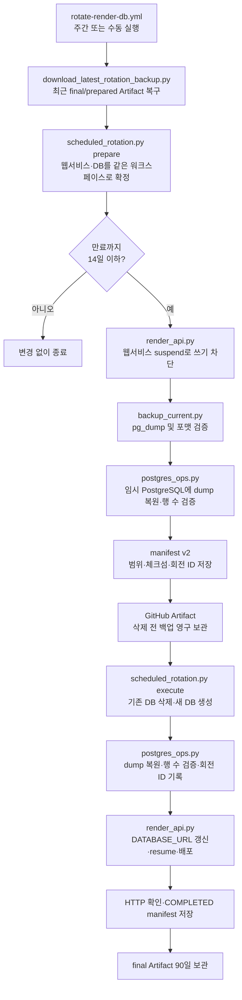

# Render Free PostgreSQL 자동 교체

LearnLog의 Render Free PostgreSQL이 만료되기 전에 데이터를 백업하고 새 DB로 교체하는 GitHub Actions 운영 가이드다.

## 운영 요약

| 항목 | 설정 |
| --- | --- |
| 회전 워크플로 | `.github/workflows/rotate-render-db.yml` |
| 실행 시간 | 매주 월요일 01:00 KST (`0 16 * * 0` UTC) |
| 교체 기준 | DB 만료까지 14일 이하 |
| 백업 포맷 | PostgreSQL custom dump |
| 회전 백업 보관 | GitHub Actions Artifact 90일 |
| DB/배포 대기 | 각각 최대 15분 |

DB는 매번 웹서비스의 워크스페이스와 `learn-log` 이름으로 다시 찾는다. Artifact의 DB ID는 중단된 회전을 안전하게 이어가기 위한 검증 정보다.

## 전체 흐름



`prepare`와 `execute`는 별도 job이다. 따라서 기존 DB 삭제는 백업 Artifact 업로드가 성공한 뒤에만 시작한다.

## GitHub 설정

Repository의 **Settings → Secrets and variables → Actions**에서 설정한다.

| 종류 | 이름 | 용도 |
| --- | --- | --- |
| 필수 Secret | `RENDER_API_KEY` | DB·웹서비스 조회, suspend/resume, DB 생성·삭제, 환경변수·배포 |
| 선택 Variable | `RENDER_WORKSPACE_ID` | 동일한 이름의 리소스가 여러 워크스페이스에 있을 때 범위 제한 |

`RENDER_WORKSPACE_ID`가 없으면 `learn-log` 웹서비스의 owner ID를 사용한다. `GITHUB_TOKEN`은 GitHub이 자동 발급하므로 따로 등록하지 않는다.

## 안전 장치

- 웹서비스를 suspend한 뒤 dump를 만들어 백업 시점 이후의 쓰기를 막는다.
- DB 삭제 전에 dump, SHA-256, 핵심 테이블 행 수, 생성 설정을 Artifact에 보관한다.
- manifest에 워크스페이스 ID, 웹서비스 ID, 원본/교체 DB ID를 넣고 매 단계에서 다시 확인한다.
- 복원 직후 새 DB의 `_learnlog_rotation_state`에 `rotation_id`를 기록한다. 이후 재실행은 같은 dump를 재적용하지 않는다.
- 복원 행 수가 manifest와 다르면 웹서비스를 새 DB에 연결하지 않는다.
- 준비 단계 실패 시 원본 DB가 남아 있으면 웹서비스를 자동 resume한다. 원본 DB가 이미 삭제됐다면 손상된 서비스 실행을 막기 위해 suspend를 유지한다.
- GitHub Actions `concurrency` group으로 동시 회전을 막는다.
- DB 접속 URL은 환경변수로만 전달하고 로그나 Artifact에 저장하지 않는다.

행 수 검증 대상은 `postgres_ops.py`의 `CHECK_QUERY`에 정의한다. 스키마가 바뀌면 이 쿼리도 함께 수정한다.

## Artifact와 재실행

아티팩트 이름은 재실행 충돌을 피하려고 `run_id`, `run_attempt`, 단계를 포함한다.

```text
render-rotation-backup-<run_id>-<run_attempt>-prepared
render-rotation-backup-<run_id>-<run_attempt>-final
└── rotation_backup/
    ├── learnlog.dump
    └── manifest.json
```

manifest phase는 `PREPARED → DB_CREATED → RESTORED → COMPLETED`로 변한다. 새 워크플로 실행은 최신 final/prepared Artifact를 받아 현재 DB와 회전 ID를 확인한 뒤 중단된 단계부터 재개한다.

| 실패 시점 | 자동 대응 |
| --- | --- |
| Artifact 저장 전 | 원본 DB를 유지하고 웹서비스 resume |
| Artifact 저장 후·DB 삭제 전 | 다음 실행에서 원본 DB 삭제부터 재개 |
| DB 삭제 후 | Artifact로 새 DB 생성·복원 재개, 그때까지 서비스 suspend |
| 복원 후 | DB의 `rotation_id`를 확인하고 dump 재적용 없이 연결·배포만 재시도 |

## 수동 점검과 실행

상태만 확인할 때는 GitHub Actions의 **Render DB Discovery**를 실행한다. DB 상태·만료일·교체 판단만 출력하고 Render 리소스를 바꾸지 않는다.

실제 교체는 **Rotate Render DB**를 `Run workflow`로 실행한다. 수동 실행에서도 14일 조건을 넘으면 변경 없이 종료한다.

## 테스트

```bash
.venv/bin/pytest -q ops/render_db_rotation
.venv/bin/ruff check ops
python3 -m compileall -q ops
git diff --check
```

Render 실제 상태 확인은 회전 엔트리포인트 대신 조회 전용 dry-run을 사용한다.

## 관련 파일

| 파일 | 역할 |
| --- | --- |
| `.github/workflows/rotate-render-db.yml` | 준비·실행 두 job으로 나뉜 주간/수동 회전 |
| `ops/render_db_rotation/scheduled_rotation.py` | prepare·execute·abort 오케스트레이션 |
| `ops/render_db_rotation/postgres_ops.py` | dump 행 수 검증, 복원, 회전 marker |
| `ops/render_db_rotation/backup_current.py` | 현재 Render DB dump와 포맷 검증 |
| `ops/render_db_rotation/download_latest_rotation_backup.py` | 최근 회전 Artifact 다운로드 |
| `ops/render_db_rotation/render_api.py` | Render API 클라이언트 |
| `ops/render_db_rotation/dry_run.py` | 조회 전용 사전 점검 |
